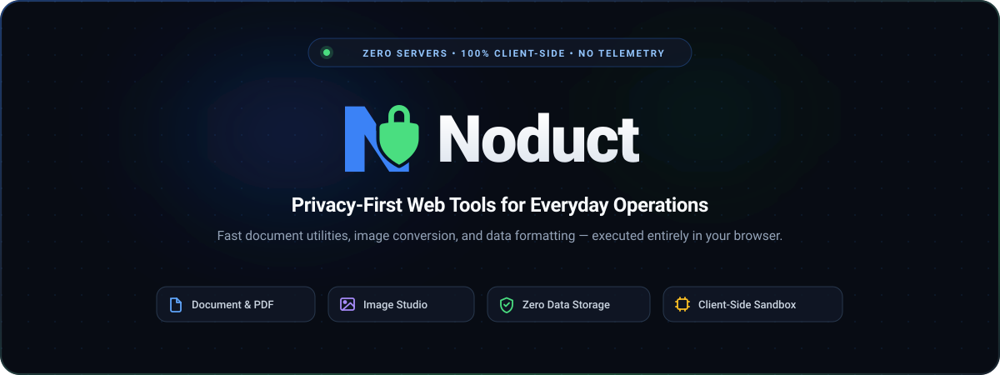

<div align="center">
  <picture>
    <source media="(prefers-color-scheme: dark)" srcset="public/brand/banner-dark.svg">
    <source media="(prefers-color-scheme: light)" srcset="public/brand/banner-light.svg">
    
  </picture>
</div>

# Noduct

Noduct is a suite of fast, private utilities for documents, images, text, data, and everyday work. Processing happens locally in the browser: no account, no upload pipeline, and no server handling your files.

## Principles

- **100% client-side:** Web APIs and browser storage keep work on your device whenever practical.
- **Clear privacy:** Every tool must accurately describe its processing behavior.
- **Accessible by default:** Semantic HTML, keyboard support, visible focus, contrast, and reduced-motion support are baseline requirements.
- **Static and lightweight:** The hub is built with Astro and ships essential content without JavaScript.

## Workspace

```text
noduct/
├── src/                    # Astro hub
├── packages/design-system/ # Reusable UI primitives and tokens
├── packages/tool-template/ # Standalone tool foundation
└── docs/                   # Architecture and operating documentation
```

## Development

```bash
npm install
npm run dev
npm run validate
```

See [DEVELOPMENT.md](DEVELOPMENT.md) for local setup and [docs/arquitetura.md](docs/arquitetura.md) for the technical architecture.

## License

Distributed under the [MIT License](LICENSE).
