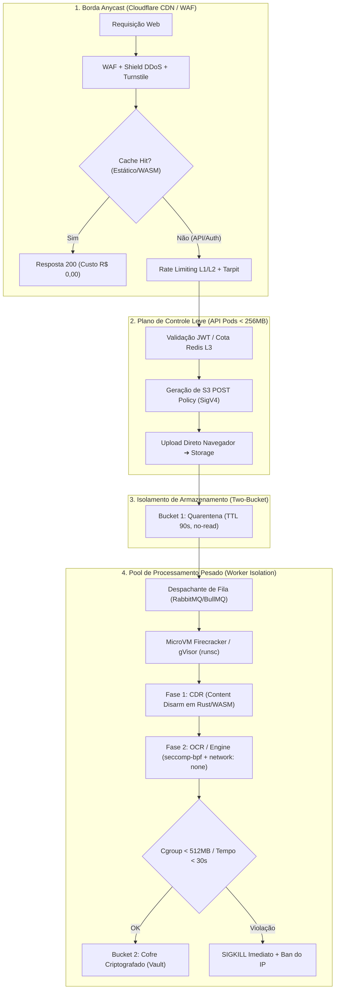
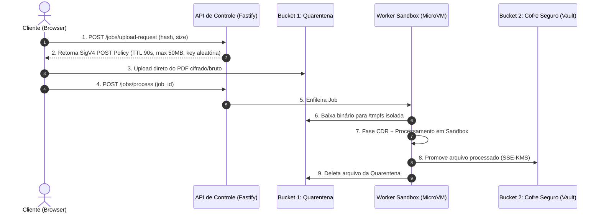

# Estudo Técnico: Arquitetura de Segurança, Isolamento e Resiliência de Backend

> **Aviso:** Este documento consolida o estudo conjunto de arquitetura defensiva (Blue Team), auditoria de exploração adversarial (Red Team) e engenharia de edge/resiliência. Trata-se de um estudo técnico exploratório para nortear um eventual backend e pool de processamento do Noduct, preservando a garantia de custo zero no tier gratuito e a inviolabilidade da infraestrutura contra ataques direcionados a processamento de documentos PDF.

---

## 1. O Desafio Central: A Equação de Custo Zero e Defesa em Profundidade

O modelo de negócio do Noduct depende de uma premissa fundamental:
> **O plano gratuito deve ter custo marginal rigorosamente zero para o operador da infraestrutura, independentemente do volume de acessos ou tentativas de abuso.**

Ao mesmo tempo, ao introduzir um backend para usuários pagantes (Pro/Teams: sincronização, OCR em nuvem e cofre criptografado), a superfície de ataque se expande exponencialmente. Parsers de PDF escritos em C/C++ (como Poppler, PDFium e bibliotecas de OCR como Tesseract/Leptonica) têm um histórico crítico de vulnerabilidades de corrupção de memória (RCE), negação de serviço e esgotamento de recursos.

A arquitetura descrita neste documento estabelece uma defesa em quatro linhas de frente:



---

## 2. Auditoria Adversarial (Red Team): Vetores Específicos de Ataque a PDF

Abaixo estão os vetores de ataque reais catalogados pela equipe ofensiva, com seus respectivos mecanismos de exploração e impacto na infraestrutura:

### 2.1. Pixel Bombs / Decompression Bombs
* **Mecanismo:** O atacante envia um arquivo PDF minúsculo (~30 KB compactado com `FlateDecode`), cujo dicionário de imagem define dimensões colossais:
  ```pdf
  << /Type /XObject /Subtype /Image /Width 100000 /Height 100000 /ColorSpace /DeviceRGB /BitsPerComponent 8 /Filter /FlateDecode >>
  ```
* **Impacto:** Ao inflar a imagem para processamento de OCR ou renderização de thumbnail, o motor tenta alocar $100.000 \times 100.000 \times 3 \text{ bytes} \approx 30 \text{ GB}$ de bitmap não comprimido em memória RAM. Sem proteções de cgroup e limites de decodificação, dispara o `OOM-killer` do Linux em menos de 80ms, derrubando o nó de processamento ou provocando *node thrashing*.

### 2.2. Billion Laughs / Expansão Quadrática em Metadados XMP
* **Mecanismo:** Injeção de DTDs com entidades aninhadas recursivamente dentro da stream de metadados XMP do PDF:
  ```xml
  <!DOCTYPE lolz [
    <!ENTITY lol "lol">
    <!ENTITY lol1 "&lol;&lol;&lol;&lol;&lol;&lol;&lol;&lol;&lol;&lol;">
    <!ENTITY lol9 "&lol8;&lol8;&lol8;&lol8;&lol8;&lol8;&lol8;&lol8;&lol8;&lol8;">
  ]>
  <x:xmpmeta><rdf:RDF><rdf:Description>&lol9;</rdf:Description></rdf:RDF></x:xmpmeta>
  ```
* **Impacto:** Se o parser XML auxiliar do motor de PDF (`libxml2`, parsers de XMP do Poppler ou wrappers) não desabilitar explicitamente a resolução de entidades externas e DTDs, uma carga de 1 KB consome até 3 GB de RAM por thread durante a extração de metadados.

### 2.3. Árvores Cíclicas de Páginas (`/Pages` Graph Loops)
* **Mecanismo:** No padrão PDF, as páginas são estruturadas em uma árvore de dicionários `/Pages` com nós intermediários e folhas `/Kids`. O atacante forja referências cruzadas circulares (ex.: o nó B aponta de volta para o nó A, ou o nó folha aponta para seu próprio pai):
  ```pdf
  3 0 obj << /Type /Pages /Kids [4 0 R] /Count 1 >> endobj
  4 0 obj << /Type /Pages /Kids [3 0 R] /Count 1 >> endobj
  ```
* **Impacto:** Motores que percorrem a árvore sem algoritmo de detecção de ciclo (Floyd's Tortoise and Hare) ou sem controle de profundidade máxima entram em recursão infinita, estourando a pilha (`Stack Overflow`) ou travando a CPU em $100\%$ indefinidamente.

### 2.4. Corrupção de Memória e RCE em Motores C/C++
* **Mecanismo:** Parsers como Ghostscript, MuPDF, Poppler e a biblioteca de imagem Leptonica (utilizada pelo Tesseract OCR) contêm código legado de manipulação aritmética de ponteiros em C. Erros de *integer overflow* no cálculo de buffer (`width * height * bpp`) resultam em alocações menores do que o necessário, seguidas de escrita fora dos limites (*heap buffer overflow* ou *use-after-free*).
* **Impacto:** Execução remota de código (RCE) no contexto do processo do worker, permitindo tentativa de fuga de container ou leitura de arquivos de outros usuários.

### 2.5. SSRF via Anotações e Ações PDF
* **Mecanismo:** O arquivo PDF contém dicionários de ação `/Action` associados a links, anotações de tela ou formulários XFA:
  ```pdf
  << /Subtype /Link /A << /S /URI /URI (http://169.254.169.254/latest/meta-data/iam/security-credentials/) >> >>
  ```
* **Impacto:** Se o motor de processamento, renderização ou conversão tentar resolver links externos, renderizar fontes remotas ou submeter formulários XFA automaticamente, o servidor requisita metadados da nuvem (AWS/GCP/Hetzner), instâncias internas de Redis (`127.0.0.1:6379`) ou APIs internas da VPC, vazando credenciais de infraestrutura.

### 2.6. Abuso de Presigned URLs e Armazenamento Fantasma
* **Mecanismo:**
  1. O atacante solicita uma URL pré-assinada para um PDF de 5 MB, mas executa um `PUT` de 50 GB caso a assinatura não trave rigorosamente o cabeçalho `Content-Length`.
  2. *Dangling uploads:* Geração de milhões de URLs pré-assinadas com upload de lixo que nunca é concluído ou notificado ao banco de dados, acumulando custo de storage de objetos sem consumir a cota da conta do usuário.
  3. *MIME Confusion:* Upload de arquivos maliciosos (SVG com scripts, HTML com phishing) mascarados como PDF para distribuição via CDN do produto.

---

## 3. Arquitetura Defensiva (Blue Team & Resiliência de Borda)

Para neutralizar todos os vetores acima sem comprometer o orçamento e mantendo custo zero no tier gratuito, as seguintes contramedidas arquiteturais são mandatórias:

### 3.1. Garantia de Custo Zero no Tier Free (Edge-First Delivery)
* **Distribuição Estática Anycast:** Hub e ferramentas são servidos via CDN global (Cloudflare Pages/Workers) com roteamento Anycast.
* **Cabeçalhos Imutáveis:** Todos os binários WASM (`pdf-lib`, adaptadores WebAssembly) e assets com hash de compilação utilizam:
  ```http
  Cache-Control: public, max-age=31536000, immutable
  ```
* **HTML com Stale-While-Revalidate:** Garante que mesmo picos virais de milhões de requisições às páginas das ferramentas sejam atendidos diretamente da memória do PoP mais próximo, gerando **zero requisições de origem e zero custo de tráfego de saída (egress R$ 0,00)**.

### 3.2. Rate Limiting em Camadas e Tarpitting Ativo
1. **L1 - Proteção na Borda (Cloudflare WAF / Shield):**
   * Terminação de conexões maliciosas lentas (Slowloris) diretamente na borda antes de tocarem a infraestrutura de origem.
   * Limite anônimo de 150 requisições/minuto por IP. Requisições excedentes recebem desafio gerenciado silencioso (Cloudflare Turnstile) sem degradar usuários humanos legítimos.
   * Rotas sensíveis (`/api/auth/*`): teto rígido de 5 requisições/minuto por IP com bloqueio temporal e tarpitting (atraso progressivo de resposta de até 10 segundos para exaurir sockets do atacante).
2. **L2 - Plano de Aplicação (Token Bucket em Redis):**
   * Rate limit atômico executado via scripts Lua no Redis, indexado pelo `sub` (ID do usuário) contido no JWT assinado.
   * Cotas diferenciadas por plano (ex.: Pro = 120 req/min de metadados; Teams = 300 req/min).
3. **L3 - Circuit Breaker e Backpressure (Opossum Pattern):**
   * Se a fila de processamento de OCR/conversão atingir 85% da capacidade do cluster, a API rejeita novas submissões imediatamente com `HTTP 503 Service Unavailable` e cabeçalho `Retry-After: 30`, impedindo acúmulo de requisições em memória e queda em cascata.

### 3.3. Desacoplamento Total de Dados (A API Nunca Toca o Binário)
* A API central (Fastify/Node ou Go/Rust) atua exclusivamente como **plano de controle leve** (< 256 MB de RAM por réplica).
* O binário do PDF **nunca trafega pela API**. A transferência ocorre diretamente entre o navegador do usuário e o Storage de Objetos através de S3 POST Policies assinadas com AWS SigV4.

### 3.4. Arquitetura de Dois Baldes (Two-Bucket Isolation)



* **Bucket 1 (Quarentena):**
  * Política POST SigV4 estrita com restrição de tamanho:
    ```json
    ["content-length-range", 1024, 52428800]
    ```
    (Rejeita no ato qualquer upload menor que 1 KB ou maior que 50 MB no nível do storage, sem consumir banda do servidor).
  * Chave de objeto gerada pelo servidor como UUID aleatório: `quarantine/{tenant_id}/{job_id}.bin`. O cliente não escolhe o nome do arquivo.
  * O cliente possui permissão única de `s3:PutObject`. **Não possui permissão de leitura (`s3:GetObject`) nem listagem**.
  * Regra de ciclo de vida (Lifecycle): deleção automática irrecuperável de qualquer objeto após 24 horas (elimina custos com uploads incompletos ou abandonados).
* **Bucket 2 (Cofre Seguro / Vault):**
  * Acessível unicamente por credenciais internas dos workers autenticados.
  * Criptografia em repouso compulsória com chaves KMS gerenciadas pelo cliente ou rotação gerenciada (SSE-KMS).

### 3.5. Sandboxing em MicroVMs e Isolamento Radical de Workers
Os workers de processamento pesado (OCR com Tesseract, manipulação com motores C/C++) rodam sob isolamento extremo:

1. **MicroVMs Efêmeras (Firecracker / gVisor `runsc`):**
   * Cada tarefa de OCR ou processamento pesado é despachada para uma MicroVM one-shot com kernel customizado e minimalista.
   * Tempo de boot inferior a 125ms.
   * Ao término do processamento, **a MicroVM é inteiramente destruída e sua memória RAM liberada**, eliminando qualquer persistência de exploits ou artefatos entre execuções de usuários diferentes.
2. **Isolamento de Rede Absoluto (`network: none`):**
   * O container de execução do motor de OCR opera com namespace de rede desativado (`--net=none`).
   * A máquina não possui placas de rede virtuais nem interface `lo` (loopback).
   * **Resultado:** Imunidade matemática a qualquer tentativa de SSRF, exfiltração de chaves via DNS ou requisição a metadados da nuvem (`169.254.169.254`).
3. **Filtro Syscall Estrito via `seccomp-bpf`:**
   * Whitelist que autoriza apenas chamadas estritamente necessárias para processamento computacional puro: `read`, `write`, `mmap`, `munmap`, `brk`, `exit_group`, `futex`.
   * Bloqueio imediato com terminação do processo (`SECCOMP_RET_KILL_PROCESS`) para chamadas como:
     * `socket`, `connect`, `bind`, `listen` (tentativa de rede);
     * `execve`, `execveat`, `fork`, `clone` (tentativa de spawnar shells ou processos secundários);
     * `ptrace` (tentativa de inspeção de processos).
4. **Cgroups v2 e Watchdog Anti-Bomba:**
   * Teto rígido de memória física: `memory.max = 512MB` sem partição de swap (evita travamento do host se ocorrer tentativa de *pixel bomb*).
   * Cota de CPU: `cpu.max = 100000 100000` (limite estrito de 1 núcleo físico).
   * Processo rootless (`nobody:nogroup`, UID/GID 65534).
   * Sistema de arquivos raiz montado em modo somente leitura (`ro`). Área de rascunho `/tmp` montada em `tmpfs` limitado a 100 MB com flags de montagem seguras: `noexec, nosuid, nodev`.
   * Watchdog ativo: sinal `SIGTERM` compulsório após 30 segundos; se não houver encerramento em 2 segundos adicionais, disparo de `SIGKILL` irrevogável.

### 3.6. Sanitização Prévia via CDR (Content Disarm & Reconstruction)
Antes de qualquer submissão de arquivo a motores pesados como Tesseract ou Ghostscript, um sanitizador ultra-rápido escrito em Rust (ou WASM isolado) inspeciona e expurga ativamente elementos maliciosos:
* **Varredura Estrutural:** Identificação e remoção cirúrgica de chaves arriscadas: `/JS`, `/JavaScript`, `/Launch`, `/EmbeddedFiles`, `/OpenAction`, `/AA` (Additional Actions), `/RichMedia` e dicionários de formulário dinâmico `/XFA`.
* **Detecção de Ciclos:** Algoritmo que rastreia os IDs de objetos visitados durante a leitura da árvore `/Pages`, abortando com erro antes de entrar em recursão infinita.
* **Validação de Cabeçalho e Metadados:** Rejeição de arquivos com dimensões nominais de imagem superiores a $8.000 \times 8.000$ pixels antes da etapa de descompressão.

### 3.7. Criptografia de Ponta a Ponta (Zero-Knowledge E2EE)
Para arquivos armazenados no cofre dos usuários Pro e Teams:
* **Chave em Posse Exclusiva do Usuário:** A criptografia de dados é realizada diretamente na máquina do cliente via WebCrypto API usando `AES-256-GCM`.
* **Derivação Segura:** Chaves de encriptação são derivadas da credencial do usuário utilizando PBKDF2 com no mínimo 600.000 iterações de SHA-256 (ou Argon2id em WebAssembly).
* **Servidor Cego:** Os bytes que repousam no storage de objetos são opacos. O servidor nunca possui a chave de descriptografia, garantindo que mesmo no caso improvável de vazamento de credenciais do storage de objetos, os documentos dos usuários permaneçam indecifráveis.

---

## 4. Matriz de Resumo: Ameaça vs. Defesa Implementada

| Ameaça (Red Team) | Impacto Teórico | Linha de Defesa Arquitetural (Blue Team) |
| :--- | :--- | :--- |
| **Pixel Bomb (Decompress)** | Esgotamento de 30GB RAM, OOM-killer | Limite cgroup de 512MB + Inspeção CDR em Rust prévia das dimensões nominais de imagem. |
| **Billion Laughs (XMP XML)** | 3GB RAM consumidos por thread | Parser XML configurado com `XML_PARSE_NOENT: false` e remoção de DTDs inline na fase CDR. |
| **`/Pages` Cyclic Loops** | Loop infinito de CPU a 100% | Rastreador de grafos com detecção de ciclo de Floyd e profundidade máxima fixada em 32 níveis. |
| **RCE em Ghostscript/Leptonica** | Tomada de controle do processo | MicroVM Firecracker efêmera (RAM destruída ao fim) + `seccomp-bpf` bloqueando `execve`/`fork` + rootless. |
| **SSRF / Exfiltração de Nuvem** | Vazamento de credenciais AWS/IAM | Namespace isolado `--net=none` (zero placas de rede no worker) + bloqueio de `socket()` via syscall filter. |
| **Abuso de Presigned URLs** | Upload de centenas de gigabytes | S3 POST Policy SigV4 com `content-length-range` restrito a 50MB e TTL de assinatura de 90 segundos. |
| **Ataque DDoS ao Tier Free** | Custos astronômicos de banda | Borda Cloudflare Anycast com cache imutável de 1 ano para WASM/JS e egresso gratuito ($0,00). |
| **Brute Force em Rotas de API** | Degradação do plano de controle | Token Bucket em Redis Lua + Tarpitting ativo no Cloudflare WAF aumentando latência de invasores. |

---

## 5. Conclusão e Diretriz para o Futuro

Este estudo demonstra que é tecnicamente viável preservar o compromisso de **custo marginal zero para o público gratuito**, ao mesmo tempo em que se viabiliza uma infraestrutura de backend **hermética e resiliente contra ataques de negação de serviço e exploits direcionados a documentos**.

Qualquer implementação futura de serviços remotos para o Noduct deverá obrigatoriamente seguir os princípios estabelecidos neste documento: desacoplamento total de dados, isolamento em MicroVMs sem rede e validação prévia em camadas (CDR).

