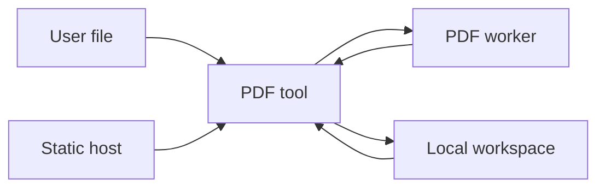

# Modelo de ameaças — processamento PDF local

**Status:** aceito em 2026-10-16. **Escopo:** futuro `pdf-core`,
`workspace-core` e ferramentas PDF; não cobre o hub atual além de seus controles
de build e hospedagem. Este modelo incorpora as confirmações do produto: todas as
ferramentas PDF compartilham a origem `noduct.github.io`; PDFs e metadados podem
ser persistidos localmente para fluxos integrados; ferramentas não PDF não usam
esse workspace; recursos externos de PDFs nunca são permitidos.

## Executive summary

O risco dominante é disponibilidade e confidencialidade no próprio navegador:
um PDF malformado pode exaurir memória/CPU, enquanto qualquer XSS ou ferramenta
não confiável na mesma origem pode ler o workspace compartilhado. Não há backend,
contas ou upload remoto no escopo. A defesa deve limitar recursos antes do parse,
isolar parsing/render em workers, desabilitar ações PDF e tratar o workspace como
dados sensíveis de mesma origem.

## Scope and assumptions

Em escopo: `packages/pdf-core/` e `packages/workspace-core/` futuros,
`packages/design-system/`, ferramentas Astro PDF e GitHub Pages. Fora de escopo:
backends, contas, APIs remotas, criptografia proprietária e ferramentas não PDF.

Assumptions validadas: o usuário seleciona arquivos locais; documentos não deixam
o dispositivo; ferramentas PDF confiáveis são publicadas pela Noduct na mesma
origem; PDFs completos podem ficar no IndexedDB para continuidade explícita de
fluxos. Questões abertas: valores finais do Resource Budget e retenção padrão dos
documentos; ambos alteram apenas o impacto de disponibilidade/privacidade.

## System model

### Primary components

- Ferramenta Astro estática: coleta arquivo local e apresenta o resultado.
- `pdf-core`: valida tamanho/estrutura e chama adaptadores de mutação ou render.
- Worker PDF: processa buffers e devolve resultado/erros sem bloquear a UI.
- `workspace-core`: IndexedDB, quota, namespace, expiração e tickets opacos.
- GitHub Pages: entrega HTML/JS/CSS próprios; `astro.config.mjs` confirma saída
  estática e base `/noduct`.

### Data flows and trust boundaries

- Usuário -> ferramenta: `File`/nome/metadados via File API; não há autenticação;
  validar tipo, tamanho, páginas e caracteres antes de persistir ou processar.
- Ferramenta -> worker: `ArrayBuffer` transferível; worker não recebe DOM nem
  rede; AbortSignal/mensagem encerra tarefas cooperativas.
- Ferramenta -> IndexedDB: PDF e metadados sob mesma origem; só ferramentas PDF
  autorizadas pelo contrato podem resolver tickets com namespace/versionamento.
- GitHub Pages -> navegador: HTTPS para artefatos próprios; CSP em meta é defesa
  complementar, não substitui headers do host.

#### Diagram

## Assets and security objectives

| Asset                            | Why it matters                                     | Security objective |
| -------------------------------- | -------------------------------------------------- | ------------------ |
| PDF bytes and metadata           | podem conter dados pessoais, contratos ou segredos | C/I/A              |
| Workspace namespace/tickets      | referencia documentos entre ferramentas            | C/I                |
| memória e CPU do cliente         | indisponibilidade derruba a ferramenta/aba         | A                  |
| artefato estático e dependências | código adulterado pode ler workspace               | I/C                |
| nomes/metadados de exportação    | podem induzir download perigoso ou UI enganosa     | I                  |

## Attacker model

### Capabilities

- Enviar PDF, nome de arquivo e metadados arbitrários ao próprio navegador.
- Induzir o usuário a abrir uma ferramenta ou documento malicioso.
- Explorar uma futura XSS, dependência comprometida ou ferramenta publicada sob a
  mesma origem.
- Criar arquivos muito grandes, profundamente aninhados ou com objetos inválidos.

### Non-capabilities

- Não há API, conta, token de usuário ou banco remoto para atacar.
- Um site de outra origem não lê IndexedDB por política de mesma origem, salvo
  XSS, extensão maliciosa ou compromisso do navegador/dispositivo.
- Links/formulários/scripts dentro de PDFs não recebem permissão para rede.

## Entry points and attack surfaces

| Surface           | How reached    | Trust boundary                  | Notes                              | Evidence                                 |
| ----------------- | -------------- | ------------------------------- | ---------------------------------- | ---------------------------------------- |
| Seleção de PDF    | File API       | usuário -> ferramenta           | entrada não confiável futura       | `AGENTS.md` exige processamento local    |
| Parser/render     | worker         | ferramenta -> engine            | bytes hostis podem causar DoS      | `docs/research/pdf-engine-evaluation.md` |
| Workspace         | IndexedDB      | ferramenta PDF -> armazenamento | mesma origem, documentos completos | issue #11; ADR 0003                      |
| Downloads         | Blob/file name | core -> usuário                 | sanitizar nome e metadados         | issue #11                                |
| Artefato estático | HTTPS          | host -> browser                 | XSS/supply-chain amplia acesso     | `astro.config.mjs`, `package.json`       |

## Top abuse paths

1. Atacante fornece PDF com streams expansíveis; parser aloca além do orçamento;
   aba trava ou cai.
2. PDF contém `/JavaScript` ou `/Launch`; renderer interpreta ação; navegação ou
   execução inesperada é disparada.
3. Nome de exportação usa controle, separadores ou `..`; UI/download induz arquivo
   enganoso ou falha de plataforma.
4. XSS em uma ferramenta PDF da mesma origem lê chaves IndexedDB e exfiltra PDFs.
5. Ferramenta simples ganha por engano acesso ao ticket/namespace PDF e vaza dados.
6. Dependência comprometida é publicada no bundle e acessa workspace/DOM.

## Threat model table

| Threat ID | Threat source             | Prerequisites              | Threat action                           | Impact                        | Impacted assets          | Existing controls (evidence)            | Gaps                                | Recommended mitigations                                                                               | Detection ideas                                   | Likelihood | Impact severity | Priority |
| --------- | ------------------------- | -------------------------- | --------------------------------------- | ----------------------------- | ------------------------ | --------------------------------------- | ----------------------------------- | ----------------------------------------------------------------------------------------------------- | ------------------------------------------------- | ---------- | --------------- | -------- |
| TM-001    | PDF hostil                | usuário abre arquivo       | bombas, objetos inválidos, loops        | travamento local              | CPU, RAM                 | limites previstos no épico              | sem motor ainda                     | pré-checar bytes/páginas, budget por operação, worker terminável, fila e timeout                      | telemetria local opt-in de falha, testes corpus   | high       | medium          | high     |
| TM-002    | PDF hostil                | parser/render aceita ações | `/JS`, `/Launch`, submit ou URL externa | rede/navegação não autorizada | privacidade, integridade | decisão de não permitir rede            | política ainda não implementada     | rejeitar/ignorar ações; `disableJavaScript`; allowlist vazia de recursos externos                     | teste de fixtures com ações                       | medium     | high            | high     |
| TM-003    | XSS/supply chain          | script roda na origem      | lê IndexedDB/tickets                    | exfiltra PDFs                 | PDFs, metadata           | static build, schemas Zod de patrocínio | origem compartilhada amplifica dano | CSP `default-src 'self'`; sem scripts terceiros; lockfile/audit; namespaces internos e consentimento  | CI de dependências, CSP reports se host suportar  | medium     | high            | high     |
| TM-004    | Ferramenta PDF defeituosa | conhece chave/ticket       | acesso cruzado indevido                 | vazamento/modificação         | workspace                | ADR 0003 proíbe ciclos                  | não há ACL de workspace             | `workspaceId` aleatório, capability ticket de uso único, escopo por ferramenta/operação, TTL e delete | testes de isolamento e auditoria local de tickets | medium     | high            | high     |
| TM-005    | Metadados hostis          | exportação                 | nome enganoso/controle                  | confusão do usuário           | integridade de download  | requisito da issue                      | utilitário ausente                  | nome canônico, remover controles, `/`, `\\`, `..`; extensão definida pela operação                    | testes unitários de casos limítrofes              | high       | low             | medium   |
| TM-006    | Artefato/dependência      | manutenção/CI comprometida | código malicioso no bundle              | leitura local silenciosa      | todos os assets          | npm lockfile e CI existentes            | SBOM/review de dependências ausente | pinning, revisão de atualização, SRI onde aplicável, audit e provenance                               | alertas de dependência/CI                         | low        | high            | medium   |

## Criticality calibration

- **critical:** execução arbitrária confirmada no browser ou exfiltração automática
  de todos os PDFs sem ação adicional do usuário.
- **high:** XSS na mesma origem, acesso cruzado ao workspace, ou DoS reproduzível
  por arquivo aceito.
- **medium:** nome de download enganoso, dependência suspeita bloqueada antes do
  deploy ou consumo alto limitado a uma única operação.
- **low:** erro local sem PDF persistido, recuperável ao recarregar/limpar dados.

## Focus paths for security review

| Path                       | Why it matters                         | Related Threat IDs |
| -------------------------- | -------------------------------------- | ------------------ |
| `packages/pdf-core/`       | parser, budget e política de ações PDF | TM-001, TM-002     |
| `packages/workspace-core/` | IndexedDB, tickets, quota e limpeza    | TM-003, TM-004     |
| `packages/design-system/`  | preview e nomes exibidos               | TM-002, TM-005     |
| `astro.config.mjs`         | origem/base/artefato estático          | TM-003             |
| `package.json` e lockfile  | supply chain e scripts de build        | TM-006             |
| `docs/privacidade.md`      | promessa pública de tratamento local   | TM-002, TM-003     |

## Policy requirements

- CSP mínima no documento: `default-src 'self'; script-src 'self'
'wasm-unsafe-eval'; style-src 'self' 'unsafe-inline'; connect-src 'self' blob:
data:; object-src 'none'; base-uri 'none'; frame-ancestors 'none'`. Usar header
  no host quando disponível; meta CSP em Pages é limitada e não cobre tudo.
- Nenhum script de terceiros, anúncio executável, CDN de engine ou fetch originado
  por conteúdo PDF. `img`, fontes e link actions do documento não são carregados.
- Persistência só após escolha explícita do usuário; exibir tamanho, quota e ação
  de apagar tudo. Aplicar TTL, LRU e limpeza ao atingir orçamento.
- Ferramentas não PDF não importam `workspace-core`; ferramentas PDF usam somente
  APIs públicas com capabilities efêmeras, não chaves IndexedDB diretas.

## Quality check

- Cobre entrada de arquivo, worker, storage, download, host e supply chain.
- Cada limite de confiança aparece em pelo menos uma ameaça.
- Separa runtime de build/CI e não inventa backend/API.
- Reflete as três confirmações do produto e deixa limites/retention como pendência
  explícita.
